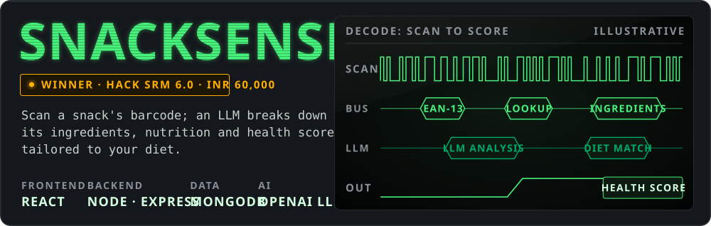
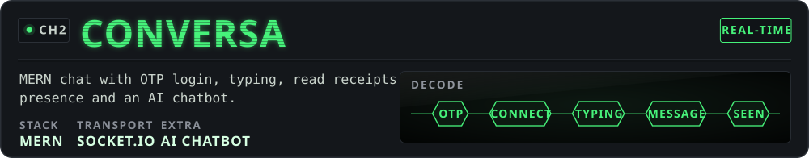
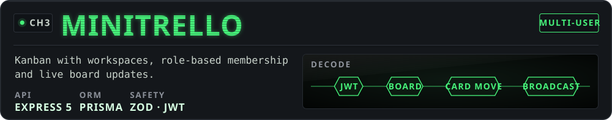
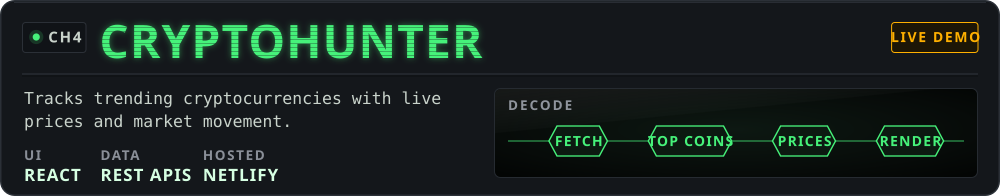
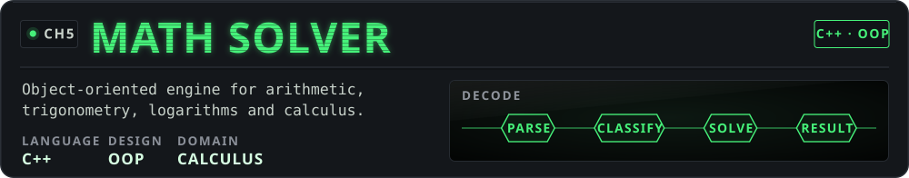
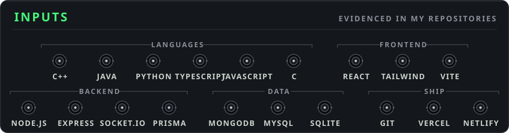

<picture><source media="(max-width: 600px)" srcset="assets/m/scope.svg" /></picture>

<a href="mailto:abhiram.pedada108@gmail.com"><picture><source media="(max-width: 600px)" srcset="assets/m/trig-0.svg" /></picture></a><a href="mailto:abhiram.pedada108@gmail.com"><picture><source media="(max-width: 600px)" srcset="assets/m/trig-1.svg" /></picture></a><a href="https://linkedin.com/in/abhirampedada"><picture><source media="(max-width: 600px)" srcset="assets/m/trig-2.svg" /></picture></a><a href="https://leetcode.com/u/tonystark50/"><picture><source media="(max-width: 600px)" srcset="assets/m/trig-3.svg" /></picture></a><a href="https://myportfolio-indol-pi.vercel.app/"><picture><source media="(max-width: 600px)" srcset="assets/m/trig-4.svg" /></picture></a>

<a href="https://github.com/Abhiram-108/SNACKSENSE."><picture><source media="(max-width: 600px)" srcset="assets/m/featured-snacksense.svg" /></picture></a>

<a href="https://github.com/Abhiram-108/CONVERSIA"><picture><source media="(max-width: 600px)" srcset="assets/m/ch-conversa.svg" /></picture></a>

<a href="https://github.com/Abhiram-108/minitrello"><picture><source media="(max-width: 600px)" srcset="assets/m/ch-minitrello.svg" /></picture></a>

<a href="https://crypto-hunter.netlify.app/"><picture><source media="(max-width: 600px)" srcset="assets/m/ch-cryptohunter.svg" /></picture></a>

<a href="https://github.com/Abhiram-108/oops-prj"><picture><source media="(max-width: 600px)" srcset="assets/m/ch-mathsolver.svg" /></picture></a>

<picture><source media="(max-width: 600px)" srcset="assets/m/inputs.svg" /></picture>

  Daily problem solving: <a href="https://github.com/Abhiram-108/leetcode">leetcode</a> (890+ commits) · <a href="https://github.com/Abhiram-108/GeekforGeeks">GeeksforGeeks</a> &nbsp;|&nbsp;
  More builds: <a href="https://github.com/Abhiram-108/Compass-Comfort">Compass Comfort</a> · <a href="https://github.com/Abhiram-108/NEWS-LIVE">News Live</a> · <a href="https://github.com/Abhiram-108/tesla-clone">Tesla clone</a> · <a href="https://github.com/Abhiram-108/C-LIBRARY-MANAGEMENT">Library Management</a>

